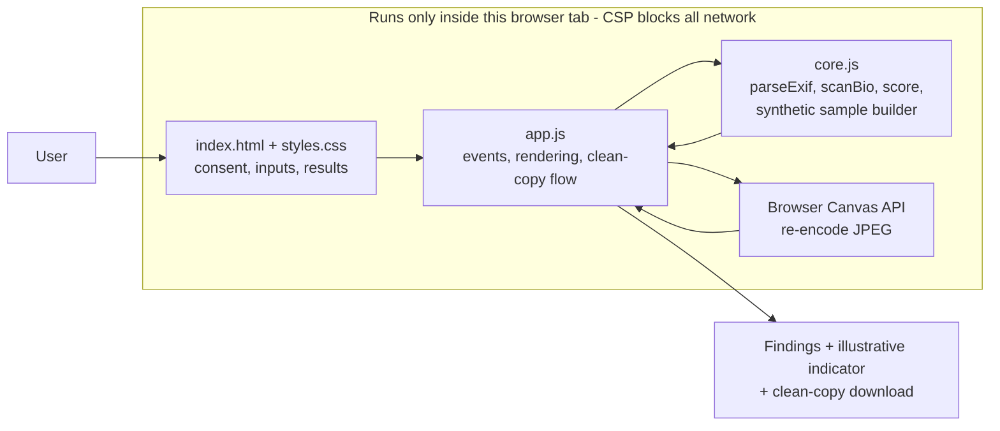
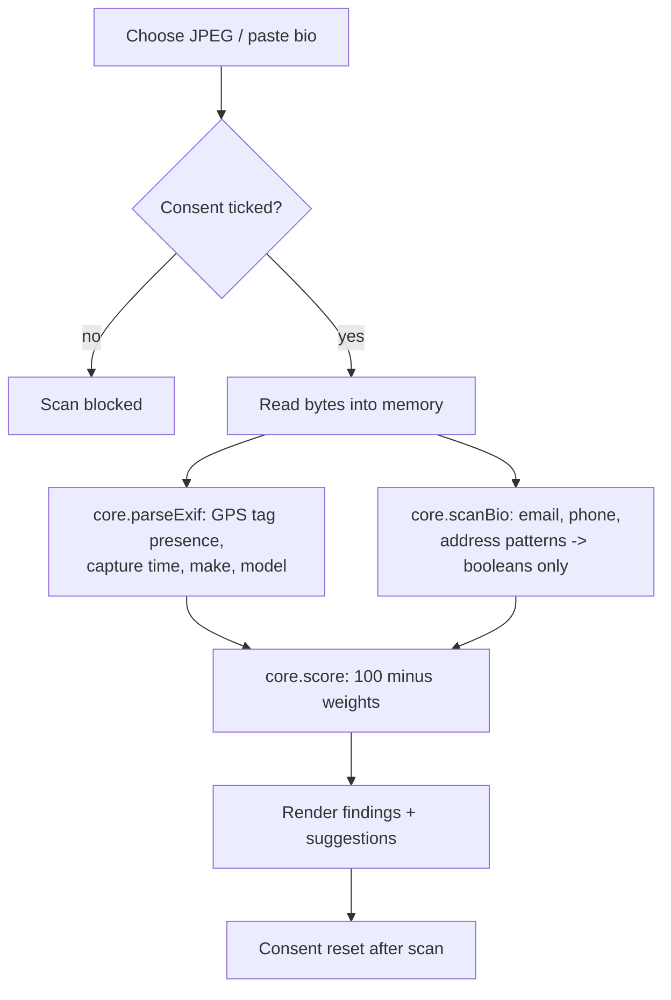
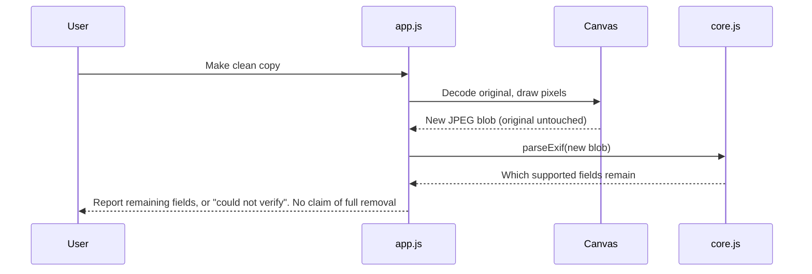

# Technical Design Document: Digital Footprint X-Ray (TEAM BYTEZZ)

## 1. Purpose and scope
A consent-based privacy self-audit that checks a user's OWN JPEG photo and public bio for common privacy clues, entirely in the browser. It raises awareness (Digital Safety & Cyber Fraud Awareness theme). It does not prevent fraud, identify people, search the internet or access accounts.

## 2. Component diagram

**scene3d.js:** renders the fictional constellation with a hand-written perspective projection on a Canvas 2D context (no library or network). Drag and arrow-key rotation; reduced-motion shows a static scene; rendering pauses when off-screen.

## 3. Local data flow

Nothing is uploaded, logged or stored. No localStorage, cookies or network calls. Reload clears all state.

## 4. Clean-copy verification

## 5. Key design decisions
- **GPS handled by presence only:** the parser reads tag IDs, never coordinate values, so coordinates cannot be shown or leaked.
- **Bio check returns booleans:** matched text is never kept or displayed.
- **Illustrative indicator:** `score = 100 - sum(weights of clue types found)`; weights: location 30, capture time 10, device 10, email 15, phone 15, address 15. Higher = fewer supported clues. Not a validated rating.
- **Security posture:** strict Content-Security-Policy (`connect-src 'none'`), no third-party scripts, no eval, DOM built with textContent (no innerHTML of user data).
- **Accessibility:** keyboard operable, visible focus, labelled controls, `aria-live` results, reduced-motion respected.

## 6. Testing
`node tests/core.test.js` (synthetic data only): EXIF presence parsing, clean-file parsing, non-JPEG rejection, bio patterns, score ordering. Manual steps in `docs/TEST_STEPS.md`. Headless-browser smoke test run during development (demo flow, consent gating, no external requests).

## 7. Limitations and future work
See `KNOWN_LIMITATIONS.md`. Future (only after testing): more formats (PNG/HEIC), XMP/IPTC checks, vernacular languages, pilot evaluation of the proposed measures.
